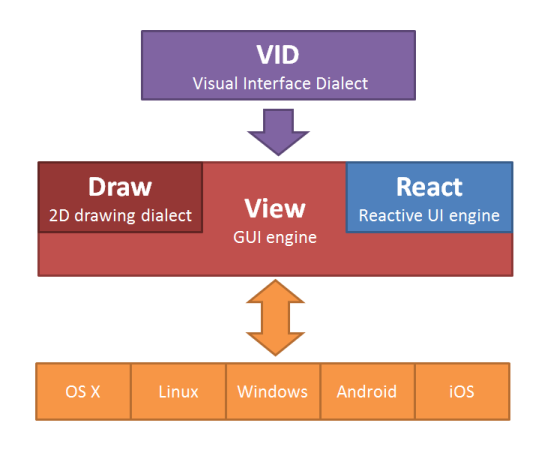

== Arquitectura GUI de Red ==

=== VID 

VID significa Visual Interface Dialect (Dialecto de Interfaz Visual). Es un dialecto de Red que proporciona la forma más simple posible de especificar componentes gráficos con sus propiedades, diseños e incluso manejadores de eventos. El código VID se compila en tiempo de ejecución a un árbol de caras adecuado para su visualización.

=== View
 
El motor de código GUI contiene varias partes:

* Motor de gestión de caras independiente de la plataforma
* Eventos de acciones reactivas
* Intérprete del dialecto Draw
* Backends específicos de plataforma

=== React

Las acciones reactivas pueden definirse desde el dialecto VID o especificarse directamente usando la función REACT.

=== Draw

Draw es un dialecto de Red para dibujo vectorial 2D. Puede ser especificado de diferentes maneras:

* en diseños VID
* directamente en la propiedad `draw` de cualquier objeto face
* usando la función DRAW para dibujar directamente sobre una imagen

=== Backends específicos de plataforma

Una API interna permite múltiples backends (combinaciones de SO/sistema gráfico) de modo que el motor View puede ser implementado en diferentes entornos. Cada backend debe ser capaz de realizar dibujo 2D extensivo para soportar completamente el dialecto Draw.

.Nota legal

Los diseños iniciales de VID, Draw y la mayoría de View (excepto las partes reactivas) fueron creados por Carl Sassenrath e implementados en Rebol. Red View es una implementación completamente nueva e independiente que proporciona características similares con algunas mejoras deseables. Las acciones reactivas son un ejemplo principal.